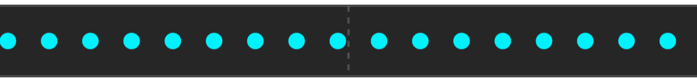

# Synapse Core


[](https://github.com/coreywaldon/synapse/actions/workflows/publish.yml)

**Advanced Reactive Operators for Kotlin Coroutines.**

Synapse extends the capabilities of standard Kotlin `Flow` by introducing a suite of powerful, time-aware, and stateful operators commonly found in functional reactive programming (FRP) but missing from the standard library.

It bridges the gap between simple Coroutines and complex event processing, handling scenarios like time-windowed deduplication, conditional gating, and sequence detection with ease.

---

## 📚 The Synapse Family

Synapse Core is one piece of a broader toolkit. If you're building a full application, the architecture layer on top is likely what you actually want:

| Module | Purpose |
|--------|---------|
| **[synapse-core](.)** | Reactive operators for Kotlin `Flow` (this library) |
| **[synapse-arch](arch/)** | Architecture framework — a typed message bus that eliminates cross-feature coordination. No ViewModels, no ad-hoc event buses. |
| **[synapse-arch-processor](arch-processor/)** | KSP processor for `@SynapseProvider` — generates the Hilt / Koin provider registry (`ksp(...)` only) |
| **[synapse-arch-hilt](arch-hilt/)** | Hilt integration for multi-module Synapse Arch projects |
| **[synapse-arch-test](arch-test/)** | Test utilities for Synapse Arch — `SynapseTestRule` + interceptor-based capture helpers |

---

## 🚀 Why Synapse?

Standard Kotlin Flows are excellent for asynchronous data, but they often lack the high-level control flow operators found in libraries like RxJava. Synapse fills this void without the overhead of a full Rx migration.

*   **Declarative Control:** Pause and resume streams without complex `Job` management.
*   **Time-Aware:** Built-in operators for pacing, squashing, and windowing events.
*   **Zero Boilerplate:** Clean, chainable extension functions that fit right into your existing Coroutines codebase.

## 📦 Installation

Add the dependency to your `build.gradle.kts`:

```kotlin
dependencies {
    implementation("com.synapselib:core:1.1.0")
}
```

See the [CHANGELOG](CHANGELOG.md) for what changed in each release.

## ⚡ Quick Start

You can wrap any existing `Flow` using `.asReactive()` or use the provided extension functions directly.

```kotlin
// Example: A robust analytics tracker that buffers when offline
// and prevents spamming the server.
analyticsEvents
    .gate(isNetworkAvailable, strategy = GateStrategy.BUFFER) // Buffer when offline
    .squash(500.milliseconds)                                 // Remove duplicates within 500ms
    .pace(100.milliseconds)                                   // Cap emission rate
    .collect { event ->
        serverApi.track(event)
    }
```

## 🧠 State Logic

Synapse treats `StateFlow<Boolean>` as a first-class citizen. You can combine multiple state flows using standard infix logic gates without the boilerplate of `combine`.

**Available Operators:** `and`, `or`, `xor`, `nand`, `nor`, `xnor`, `imp`, `nimp`, `not` (also usable as the prefix `!`).

```kotlin
val isFormValid: StateFlow<Boolean> = ...
val isNetworkAvailable: StateFlow<Boolean> = ...
val isSubmitting: StateFlow<Boolean> = ...

// Combine states declaratively
val canSubmit = (isFormValid and isNetworkAvailable) and !isSubmitting
```

Derived flows compute `.value` synchronously and, like any `StateFlow`, never emit two equal values in a row.

## 📚 Core Operators

### `gate`
**Control Flow Valve**

Acts as a controllable valve for your data stream. You can pause execution based on a secondary boolean flow.

| Strategy | Description | Use Case |
| :--- | :--- | :--- |
| `BUFFER` | Queues events when closed, emits them in order when opened. | Analytics, offline syncing. |
| `LATEST` | Keeps only the most recent event when closed. | UI State updates. |
| `DROP` | Ignores all events when closed. | Sensor noise, temporary muting. |

<details>
<summary><b>View Examples & Visuals</b></summary>

#### Strategy: LATEST
Perfect for UI states where intermediate values don't matter.


#### Strategy: BUFFER
Ideal for analytics or critical data that cannot be lost while offline.


#### Strategy: DROP
Useful for ignoring sensor noise during specific physical states.


```kotlin
analyticsFlow.gate(isNetworkAvailable, GateStrategy.BUFFER)
    .collect { sendToServer(it) }
```
</details>

The condition can be a `StateFlow<Boolean>` or any `Flow<Boolean>`. The gate starts **closed** until the condition emits its first value. `bufferCapacity` (default unbounded, must be positive) caps the `BUFFER` queue by dropping the oldest items.

**Completion:** the gated flow completes normally once the upstream has completed *and* nothing it holds is still waiting for the gate to open. That means an empty buffer for `BUFFER`, no stored value for `LATEST`, and immediately for `DROP`. Upstream errors propagate immediately, even while the gate is closed.

---

### `squash`
**Time-Windowed Deduplication**

Unlike `distinctUntilChanged`, `squash` forgets the value after a specific retention period, allowing it to be re-emitted if it occurs again later.

> **Use Case:** Preventing double-clicks or spammy error logs that need to be reported occasionally, but not continuously.

```kotlin
buttonClicks
    .squash(retentionPeriod = 500.milliseconds)
    .collect { handleClick() }
```

Optional parameters: `maxDistinctValues` (default 100; the oldest tracked value is evicted when full), `shouldSquash` (values for which it returns `false` always pass), and `timeSource` (see [Testing time-based operators](#-testing-time-based-operators)).

---

### `pace`
**Rate Limiting (Smoothing)**

Limits the rate of emissions by ensuring a minimum time `interval` elapses between items. Unlike `debounce`, this does not drop items; it delays them to smooth out the stream.

> **Use Case:** Smoothing out complex rendering updates to prevent UI jank.

```kotlin
renderRequests
    .pace(interval = 16.milliseconds) // Cap at ~60fps
    .collect { renderFrame(it) }
```

The first item is emitted immediately. The gap is measured from when the previous emission returned.

---

### `combo`
**Sequence Detection**

Detects specific sequences of values emitted within a defined time window. It utilizes a Trie-based automaton to efficiently match sequences of inputs against a set of target sequences.

```kotlin
val konamiCode = listOf(UP, UP, DOWN, DOWN, LEFT, RIGHT, LEFT, RIGHT, B, A)

inputEvents
    .combo(sequences = listOf(konamiCode), interval = 2.seconds)
    .collect { println("Cheat Code Activated!") }
```

`interval` is the maximum gap between two inputs; a longer pause resets the detection. (The equivalent parameter of the `ReactiveFlow.combo` member is named `timeout`.) Empty sequences are ignored.

**Greedy matching** (`greedy = true`): when a match is a prefix of a longer target (e.g. `[A, B]` and `[A, B, C]`), the short match is *held* while input keeps following the longer path. If the longer sequence completes, only it is emitted. Otherwise the held match is emitted as soon as an input breaks the chain, when no input arrives within `interval` of the last step, or when the upstream completes. The breaking input can itself start a new combo.

```kotlin
inputEvents
    .combo(sequences = listOf(listOf(A, B), listOf(A, B, C)), interval = 300.milliseconds, greedy = true)
    .collect { match -> println("Matched $match") } // A, B, C → [A, B, C] only; A, B, X → [A, B]
```

---

### `chunk`
**Bundling signals**

Take an input value, then waits until a duration is up. Combines all values in that period into a list, then emits it.

```kotlin
// Example: Batching log entries every 5 seconds or when 100 items are reached
logFlow
    .chunk(period = 5.seconds, maxBufferSize = 100)
    .collect { batch ->
        cloudLogger.sendBatch(batch)
    }
```

Empty chunks are never emitted, and `period` must be positive. When the upstream completes, the remaining partial chunk is emitted. When it fails, the partial chunk is dropped and the error is rethrown.

---

### `shutter`
**Trigger-Based Sampling**

Samples the latest value from the upstream flow only when a secondary trigger flow emits. Acts like a camera shutter.

```kotlin
// Read sensor value only when user clicks "Measure"
sensorReadings
    .shutter(trigger = measureButtonClick)
    .collect { recordMeasurement(it) }
```

Triggers that arrive before the upstream's first value are ignored, and every trigger samples, so the same value can be emitted repeatedly.

**Completion:** the sampled flow completes when the **trigger** completes, and the upstream collection is then cancelled. Upstream completion does *not* end it: the last value stays available to later triggers. An error from either side fails the flow.

---

### `resilient`
**Retry with Exponential Backoff**

Re-collects the upstream when it fails, waiting `initialDelay * factor^attempt` before each retry (attempt starts at 0). Fractional factors are applied exactly, and the delay saturates instead of overflowing. Cancellation is never retried, and after `maxRetries` the error propagates.

```kotlin
api.observePrices()
    .resilient(maxRetries = 5, initialDelay = 200.milliseconds, factor = 1.5) // 200ms, 300ms, 450ms, …
    .collect { render(it) }
```

> The `Flow.resilient` extension defaults `initialDelay` to `Duration.ZERO` (immediate retries). The `ReactiveFlow.resilient` member defaults to 100 ms.

---

## ⏱️ Testing time-based operators

`squash`, `pace` and `combo` read the current time from a `kotlin.time.TimeSource`. They wait with coroutine `delay`, so the two must agree. Production code uses `TimeSource.Monotonic` (the default). Under `kotlinx-coroutines-test`, pass the test scheduler's virtual clock:

```kotlin
@Test
fun pacesEvents() = runTest {
    val paced = events.pace(100.milliseconds, testTimeSource).toList()
    // ...
}

// Or wrap once: every chained ReactiveFlow operator keeps the same time source.
events.asReactive(testTimeSource)
    .squash(500.milliseconds)
    .pace(100.milliseconds)
```

The `() -> Long` nanosecond-clock overloads of `ReactiveFlow(...)`, `squash`, `pace` and `combo` are deprecated in favor of `TimeSource`.

## 🤝 Contributing

Contributions are welcome! Please feel free to submit a Pull Request.

## 📄 License

Synapse is available under the Mozilla Public License 2.0. See the [LICENSE](LICENSE) file for more info.
