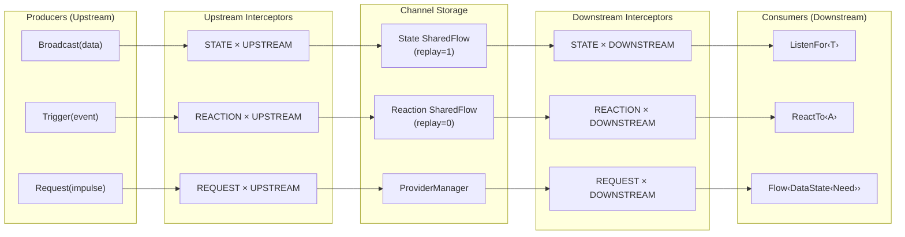
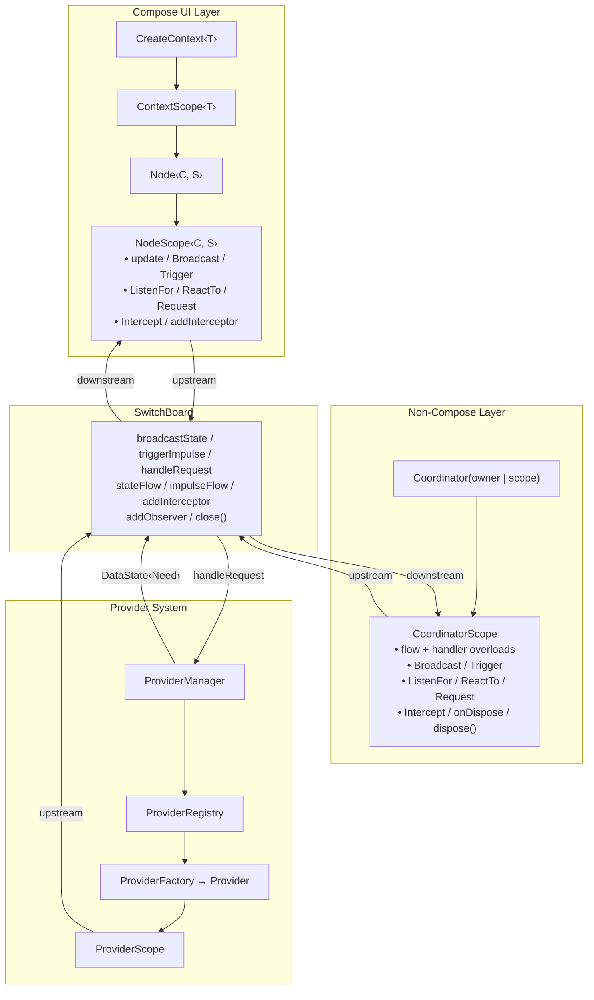
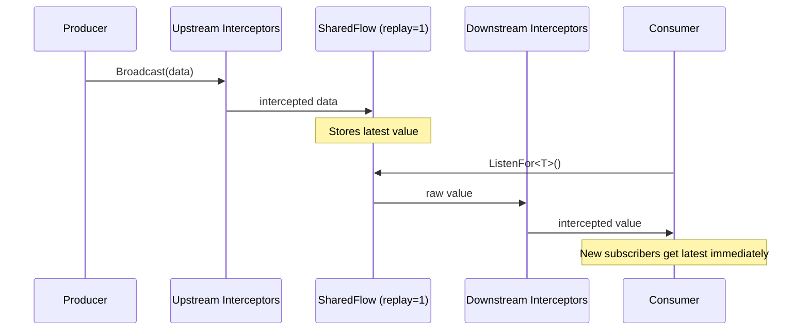
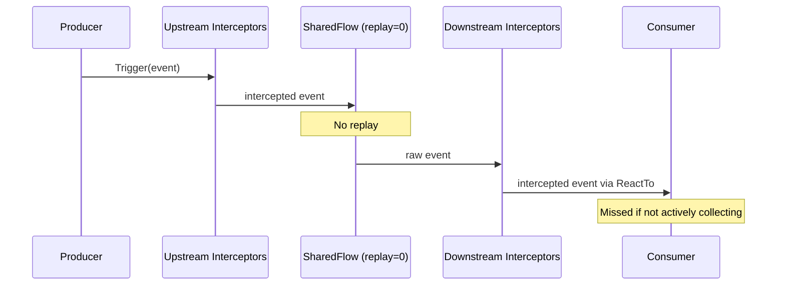
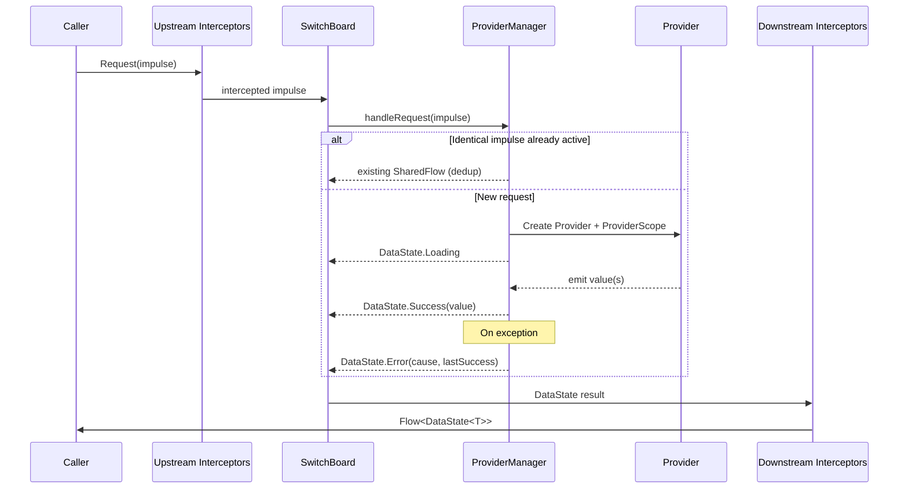
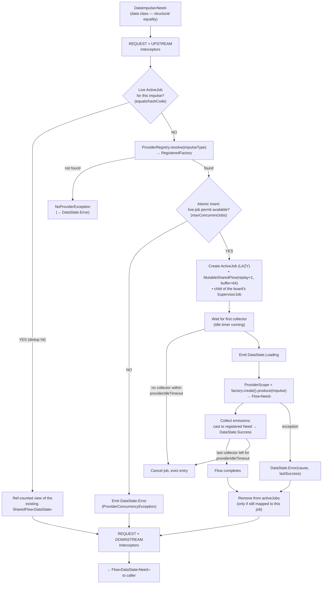
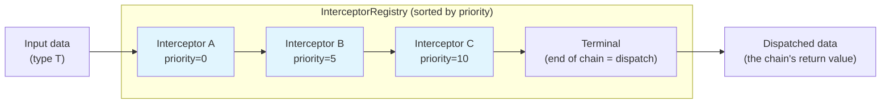

# Synapse Arch


[](https://github.com/coreywaldon/synapse/actions/workflows/publish.yml)

**Architecture framework for Kotlin/Compose that eliminates the coordination problem.**

Every component in a Synapse application is an isolated state machine with typed inputs and outputs. Components never reference each other — they communicate exclusively through a central **SwitchBoard** that routes **state**, **reactions**, and **data requests** with a composable interceptor pipeline at every stage. The coupling between any two components is zero beyond the impulse types they share.

This gives you a property most architectures can't: **compositional correctness**. If Component A works through the SwitchBoard and Component B works through the SwitchBoard, then A + B works — because the bus is real, never mocked, and the type system enforces the contract.

There are no ViewModels. **Compose** screens use the `Node`/`CreateContext` DSL. **Non-Compose** contexts use `Coordinator`. Data fetching is handled by **Providers** wired automatically via KSP through Hilt or Koin.

---

## 📑 Contents

**Orientation**
- [What you get](#-what-you-get)
- [Installation](#-installation)
- [Quick Start](#-quick-start)
- [Reading the Quick Start](#-reading-the-quick-start)
- [Three Channels](#-three-channels) — State, Reaction, Request
- [How it fits together](#-how-it-fits-together)

**Learn by doing**
- [Building a Screen](#-building-a-screen)
- [Compose DSL](#-compose-dsl) — `CreateContext`, `Node`, `NodeScope`, [state persistence](#state-persistence)
- [Coordinators (Non-Compose)](#-coordinators-non-compose)
- [Organizing Impulses & State](#-organizing-impulses--state)
- [Interceptors](#-interceptors)
- [Providers & Data Fetching](#-providers--data-fetching)
- [Scaling to Large Apps](#-scaling-to-large-apps)

**Reference**
- [Core Types](#-core-types) — `Impulse`, `DataImpulse`, `DataState`, `SwitchBoard`

**Deep dive**
- [Observability](#-observability) — observers, `TraceContext`
- [Architecture Diagrams](#-architecture-diagrams)
- [Performance](#performance) — benchmark numbers

**Evaluation**
- [How Synapse Compares](#-how-synapse-compares) — vs MVVM, MVI, RIBs, Circuit

**Footer**
- [Testing](#-testing)
- [License](#-license)

---

## ✨ What you get

- **Zero coupling between features** — components share only impulse types; adding Feature B never requires modifying Feature A.
- **Cross-cutting concerns as first-class operations** — auth token injection, analytics, session management are interceptors, not bolted onto a repository layer.
- **Real-bus testing, no mocks** — [synapse-arch-test](../arch-test/README.md) runs tests through the actual SwitchBoard with interceptor-based capture.
- **Compose-native** — `CreateContext` + `Node` replace the ViewModel entirely; no ceremony.
- **KSP-wired DI** — `@SynapseProvider` + [arch-processor](../arch-processor/README.md) for Hilt or Koin, multi-module out of the box via [synapse-arch-hilt](../arch-hilt/README.md).
- **Benchmarked** — ~200 ns overhead per SwitchBoard op, ~20 µs per Node in Compose composition, linear scaling at every layer. See [Performance](#performance).
- **Honest about trade-offs** — full comparison vs MVVM/MVI/RIBs/Circuit at the bottom: [How Synapse Compares](#-how-synapse-compares).

---

## 📦 Installation

```kotlin
dependencies {
    implementation("com.synapselib:arch:1.1.0")
}
```

For KSP provider generation (`@SynapseProvider`), also apply KSP and add the processor:

```kotlin
plugins {
    id("com.google.devtools.ksp")
}

dependencies {
    ksp("com.synapselib:arch-processor:1.1.0")
}
```

For multi-module Hilt projects, add the aggregator in your app module:

```kotlin
dependencies {
    implementation("com.synapselib:arch-hilt:1.1.0")
}
```

> **Migrating from 1.0.x:** the KSP processor moved out of the `arch` runtime artifact into its own
> compile-only artifact, [`arch-processor`](../arch-processor/README.md). Replace
> `ksp("com.synapselib:arch:<version>")` with `ksp("com.synapselib:arch-processor:<version>")`.
> `arch` no longer drags `dagger-compiler`, KSP, AutoService or Compose Foundation onto your runtime
> classpath — if your app relied on any of them transitively, declare them directly. See the
> [CHANGELOG](../CHANGELOG.md) for the other 1.1.0 behavior changes.

---

## ⚡ Quick Start

```kotlin
@Composable
fun ProductScreen(appServices: AppServices) {
    CreateContext(appServices) {
        Node(initialState = ScreenState()) {
            // Fetch data — handler receives DataState<T> lifecycle updates
            Request(impulse = FetchProducts(filter = "popular")) { dataState ->
                update { it.copy(products = dataState) }
            }

            // Subscribe to global state (replay=1, gets latest immediately)
            ListenFor<SessionState> { session ->
                update { it.copy(session = session) }
            }

            // React to fire-and-forget events (no replay)
            ReactTo<NavigateTo> { impulse ->
                navController.navigate(impulse.route)
            }

            Scaffold {
                when (val products = state.products) {
                    is DataState.Loading -> CircularProgressIndicator()
                    is DataState.Success -> ProductList(products.data)
                    is DataState.Error -> ErrorMessage(products.cause)
                    else -> {}
                }
            }
        }
    }
}
```

---

## 🧭 Reading the Quick Start

The Quick Start uses five constructs. Here's the 30-second vocabulary:

| Construct | Purpose |
|-----------|---------|
| `CreateContext(appServices)` | Passes shared services to all child composables without prop drilling |
| `Node(initialState = ...)` | Screen-local state holder — replaces the ViewModel |
| `Request(impulse) { ... }` | Fetch data via a Provider, receive `DataState<T>` lifecycle updates (`Loading` / `Success` / `Error`) |
| `ListenFor<T> { ... }` | Subscribe to a global state broadcast (replay=1, latest on subscribe) |
| `ReactTo<T> { ... }` | Handle a fire-and-forget event (replay=0, only active collectors receive) |

Each of these lands on one of three channels — covered next.

---

## 🔀 Three Channels

| Channel      | Replay | Produce            | Consume                     | Purpose                                                              |
|--------------|--------|--------------------|-----------------------------|----------------------------------------------------------------------|
| **State**    | 1      | `Broadcast(data)`  | `ListenFor<T> { ... }`     | Persistent state streams — new subscribers get the latest value      |
| **Reaction** | 0      | `Trigger(event)`   | `ReactTo<A> { ... }`       | Fire-and-forget events — only active collectors receive them         |
| **Request**  | 1      | `Request(impulse)` | `Request(impulse) { handler }` | Data fetching via Providers — full lifecycle (Loading/Success/Error) |

---

## 🗺️ How it fits together

Producers emit on one of three channels. Interceptors run upstream and downstream of each channel. Consumers subscribe by type — they never hold references to producers.



Six more diagrams zooming into each flow live in [Architecture Diagrams](#-architecture-diagrams) for readers who want the full picture.

---

## 📘 Building a Screen

A typical screen follows the `CreateContext → Node → UI` pattern. The `CreateContext` provides shared services; the `Node` holds screen-local state; the composable body renders UI.

```kotlin
// 1. Define screen state
@Serializable
data class CheckoutState(
    val addresses: DataState<List<Address>> = DataState.Idle,
    val selectedAddress: Address? = null,
    val isSubmitting: Boolean = false,
)

// 2. Define impulses for cross-component communication (not local state changes)
object Checkout {
    data class Submit(val addressId: String) : Impulse()
}

// 3. Build the screen
@Composable
fun CheckoutScreen(appServices: AppServices) {
    CreateContext(appServices, tag = "CheckoutScreen") {
        Node(initialState = CheckoutState()) {
            // Data loading
            Request(impulse = FetchAddresses()) { dataState ->
                update { it.copy(addresses = dataState) }
            }

            // React to submit (fired by child composable via Trigger)
            ReactTo<Checkout.Submit> {
                update { it.copy(isSubmitting = true) }
            }

            // Global state subscription
            ListenFor<SessionState> { session ->
                if (session is SessionState.LoggedOut) {
                    scope.launch { Trigger(NavigateTo("login")) }
                }
            }

            // UI — no callbacks passed down
            CheckoutContent()
        }
    }
}

// Child composable as a NodeScope extension — bus access plus the Node's `state` / `update`,
// without prop drilling
@Composable
fun NodeScope<AppServices, CheckoutState>.CheckoutContent() {
    val addresses = state.addresses.dataOrNull.orEmpty()

    // Local state — update directly from click handler, no impulse needed
    LazyColumn {
        items(addresses) { addr ->
            AddressRow(
                address = addr,
                isSelected = addr == state.selectedAddress,
                modifier = Modifier.clickable {
                    update { it.copy(selectedAddress = addr) }
                },
            )
        }
    }

    Button(
        // Cross-component action — fire an impulse
        onClick = {
            scope.launch { Trigger(Checkout.Submit(state.selectedAddress!!.id)) }
        },
        enabled = state.selectedAddress != null && !state.isSubmitting,
    ) {
        Text(if (state.isSubmitting) "Submitting..." else "Place Order")
    }
}
```

**No callback threading.** Bus-aware child composables (`ContextScope` / `NodeScope` extensions) should never receive `onSomething` lambdas that thread state changes back to a parent Node. Instead, children fire impulses through the bus via `Trigger()`, and the Node reacts to them with `ReactTo`. This keeps components decoupled — they communicate through typed impulses, not callback chains.

Passing **read-only display data** as parameters is fine. Passing lambdas to **pure UI leaf components** (things like `AddressRow`, `Button` — not scope extensions) is also fine, since they don't participate in the bus.

```kotlin
// Anti-pattern: callback threading
CheckoutContent(
    onSubmit = { scope.launch { Trigger(Checkout.Submit(id)) } },  // ❌
)

// Correct: pass read-only data, child fires impulses directly
ProductCard(isFavorited = true, quantityInCart = 3)  // ✅ read-only data as params
coroutineScope.launch { Trigger(Cart.AddItem(product.id, qty = 1)) }  // ✅ child fires impulse
```

**Use impulses for cross-component communication.** Use `update` directly for screen-local state changes (e.g., selecting an address, toggling a filter). Only create an impulse when the action needs to cross component boundaries.

---

## 🖼️ Compose DSL

### `CreateContext`

Establishes a context boundary pairing an arbitrary value with the nearest `SwitchBoard`:

```kotlin
CreateContext(appServices) {
    // `this` is ContextScope<AppServices>
    Node(initialState = UiState()) {
        // `this` is NodeScope<AppServices, UiState>
    }
}
```

Optional `tag` parameter enables [tracing](#-observability):

```kotlin
CreateContext(appServices, tag = "CheckoutScreen") { ... }
```

**Nested contexts** — use `CreateContext` inside a Node to change the context type for child components:

```kotlin
CreateContext(appServices) {
    Node(initialState = HomeState()) {
        Request(impulse = FetchProducts(filter)) { dataState ->
            update { it.copy(products = dataState) }
        }

        state.products.dataOrNull?.forEach { product ->
            // Switch context to Product — child composables get typed access
            CreateContext(product) {
                ProductCard()
            }
        }
    }
}
```

### `Node` & `NodeScope`

Creates a stateful node inside a `ContextScope`. The fundamental unit of the Compose DSL.

**NodeScope capabilities:**

| Category                       | Method                                         | Composable?  |
|--------------------------------|------------------------------------------------|--------------|
| **Local state**                | `update { reducer }`                           | No           |
| **State broadcast**            | `Broadcast(data)`                              | No (suspend) |
| **Reactions**                  | `Trigger(event)`                               | No (suspend) |
| **Interception**               | `Intercept(point, interceptor, priority, key)` | Yes          |
| **Interception (imperative)**  | `addInterceptor(point, interceptor, priority)` → `Registration` | No |
| **Request**                    | `Request(impulse, key) { handler }`            | Yes          |
| **Listen (state)**             | `ListenFor(stateKey) { handler }`              | Yes          |
| **Listen (reaction)**          | `ReactTo(reactionKey) { handler }`             | Yes          |
| **Flows**                      | `ListenFor<O>()`, `ReactTo<A>()`, `Request(impulse)` | No — return flows |

**Properties:**

| Property      | Type             | Purpose                                                            |
|---------------|------------------|--------------------------------------------------------------------|
| `context`     | `C`              | Read-only access to the value from `CreateContext`                 |
| `state`       | `S`              | Current snapshot of local state (triggers recomposition on change) |
| `scope`       | `CoroutineScope` | For launching coroutines (e.g., to `Trigger` from click handlers) |
| `switchboard` | `SwitchBoard`    | The board inherited from the enclosing `ContextScope`              |
| `tag`         | `String?`        | The trace tag inherited from the enclosing `ContextScope`          |
| `isDisposed`  | `Boolean`        | `true` once the Node has left the composition                      |

**Shared verbs.** `ContextScope`, `NodeScope`, `CoordinatorScope` and `ProviderScope` all extend `SynapseScope`, which implements `Broadcast`, `Trigger` and the flow-returning `ListenFor<O>()`, `ReactTo<A>()` and `Request(impulse)` once. You can write reusable helpers against it:

```kotlin
suspend fun SynapseScope.announceLogin(user: User) {
    Broadcast(SessionState.Authenticated(user))
    Trigger(NavigateTo("home"))
}
```

**Scope extensions** — the standard pattern for child composables. Declaring a composable as a `ContextScope<T>` extension gives it `context`, `coroutineScope` (composition-bound), `Trigger`, `Broadcast` and the flow verbs without prop drilling. When the child also needs the Node's `state` / `update`, declare it as a `NodeScope<C, S>` extension instead (as `CheckoutContent` does above).

```kotlin
// Child composable — extension on ContextScope gives bus access
@Composable
fun ContextScope<Product>.ProductCard() {
    val product = context  // typed access to the Product from CreateContext
    Card(
        modifier = Modifier.clickable {
            coroutineScope.launch { Trigger(Cart.AddItem(product.id, qty = 1)) }
        }
    ) {
        Text(product.name)
        Text(product.formattedPrice)
    }
}
```

`Trigger` and `Broadcast` are suspend functions. Use `scope.launch { }` (in a `NodeScope`) or `coroutineScope.launch { }` (in a `ContextScope`) from non-suspend contexts like click handlers.

**Lifecycle-aware effects** (`ListenFor`, `ReactTo`, `Request`, `Intercept`) use `DisposableEffect` internally — canceled and relaunched when their key changes, canceled when the composable exits.

**Interceptors in a Node.** `Intercept` is `@Composable`. It registers its interceptor **once** per distinct (`point`, `priority`, `key`) and removes it when the call leaves the composition. Recomposition doesn't re-register, and the latest `interceptor` lambda is always the one invoked, so it is safe to capture fresh state. Outside the composable body (click handlers, effects, coroutines), use `addInterceptor`. It registers on every call, returns a `Registration`, and is unregistered automatically when the Node is disposed:

```kotlin
Node(initialState = ScreenState()) {
    // Composable body: registered once, follows the latest `state`
    Intercept<NetworkRequest>(
        point = InterceptPoint.REQUEST_UPSTREAM,
        interceptor = Interceptor.transform { req -> req.copy(token = state.authToken) },
    )

    // Imperative: from an effect or callback
    LaunchedEffect(userId) {
        val registration = addInterceptor<AnalyticsEvent>(
            InterceptPoint.REACTION_UPSTREAM,
            Interceptor.transform { it.copy(userId = userId) },
        )
        try { awaitCancellation() } finally { registration.unregister() }
    }
}
```

**Putting it together** — local state, listeners and a request in one Node:

```kotlin
Node(initialState = ScreenState()) {
    Text("Count: ${state.count}")

    Button(onClick = { update { it.copy(count = it.count + 1) } }) {
        Text("Increment")
    }

    ListenFor<ThemeSettings> { settings ->
        update { it.copy(darkMode = settings.darkMode) }
    }

    ReactTo<NavigateTo> { event ->
        navController.navigate(event.route)
    }

    Request(impulse = FetchUserProfile(userId = 42)) { dataState ->
        update { it.copy(profileState = dataState) }
    }
}
```

### State persistence

If the state class `S` is `@Serializable` (kotlinx.serialization), `Node` keeps it in `rememberSaveable`, so it survives configuration changes (rotation) and process death. It is saved as a JSON string; a state class that is not `@Serializable` is simply `remember`ed and starts over from `initialState` when the Activity is recreated.

Apply the serialization plugin in the module that declares your state classes:

```kotlin
plugins {
    id("org.jetbrains.kotlin.plugin.serialization") version "<your Kotlin version>"
}
```

Keep fetched data wrapped in `DataState` — it is `@Serializable` itself, so this works as long as the data type (`Product` here) is `@Serializable` too:

```kotlin
@Serializable
data class Product(val id: Int, val name: String)

@Serializable
data class ProductListState(
    val products: DataState<List<Product>> = DataState.Idle,
    val searchQuery: String = "",
)

Node(initialState = ProductListState()) {
    Request(impulse = FetchProducts(filter = "popular")) { dataState ->
        update { it.copy(products = dataState) }
    }
    // ...
}
```

What comes back after a restore:

| Saved                         | Restored                                                                                     |
|-------------------------------|----------------------------------------------------------------------------------------------|
| `Idle` / `Loading`            | The same `DataState.Idle` / `DataState.Loading` singletons                                   |
| `Success(data)`               | `Success(data)`                                                                              |
| `Error(cause, staleData)`     | `Error(RestoredDataStateException(originalType, message), staleData)`                        |

A `Throwable` can't be serialized, so an `Error` keeps only its cause's class name and message: the restored `cause` is a `RestoredDataStateException` whose `message` is the original message and whose `originalType` is the original class name (e.g. `"java.io.IOException"`). The original exception's identity, type and stack trace are **not** preserved, so don't branch on `cause is IOException` for restored state. `staleData` is preserved. Either way, the restored value is only what the first frame shows: the `Request` runs again after restoration and re-emits the real state (`Loading`, then `Success` / `Error`).

Every other property of the state class must be serializable too. A property typed as an interface that isn't `@Serializable` compiles fine (the plugin treats it as polymorphic) but throws a `SerializationException` when the state is saved — the crash `DataState` itself caused before 1.1.0.

---

## 🎛️ Coordinators (Non-Compose)

For business logic outside Compose — activities, services, background processes.

### Creating a Coordinator

```kotlin
val coordinator = Coordinator(switchboard, lifecycleOwner) {
    ListenFor<AppConfig> { config ->
        applyConfig(config)
    }

    ReactTo<SessionExpired> {
        launch { Trigger(NavigateToLogin) }
    }

    Intercept<AnalyticsEvent>(
        point = InterceptPoint(Channel.REACTION, Direction.UPSTREAM),
        interceptor = Interceptor.read { event -> analytics.track(event) },
    )
}
```

Auto-disposes on `ON_DESTROY`. Call `coordinator.dispose()` for earlier cleanup (idempotent, thread-safe). If the owner is already `DESTROYED`, the coordinator is disposed immediately, and if the block throws, it is disposed before the exception is rethrown.

Optional `tag` parameter enables [tracing](#-observability):

```kotlin
val coordinator = Coordinator(switchboard, lifecycleOwner, tag = "AuthCoordinator") { ... }
```

### Lifecycle Hooks

Register callbacks for any Android lifecycle event directly inside the coordinator block:

```kotlin
Coordinator(switchboard, lifecycleOwner) {
    onStart {
        launch { Broadcast(SessionActive) }
    }

    onStop {
        launch { Broadcast(SessionInactive) }
    }
}
```

Available hooks: `onCreate`, `onStart`, `onResume`, `onPause`, `onStop`, `onDestroy`.

Hooks behave the same no matter *when* they are registered:

- **Up-events** (`onCreate`, `onStart`, `onResume`) whose state the owner has **already reached** fire immediately, then again on every later occurrence. The builder attaches its lifecycle observer *after* the block, so hooks registered in the block are replayed in lifecycle order. With an already-resumed owner such as `ProcessLifecycleOwner`, `onStart { }` fires right after the block.
- **Down-events** (`onPause`, `onStop`, `onDestroy`) are never replayed; they fire the next time the event happens.
- Multiple callbacks for the same event execute in registration order. Hooks registered after `dispose()` are ignored.

### Teardown: `onDispose` and `isDisposed`

`onDispose { }` runs exactly once when the coordinator is disposed — manually, on `ON_DESTROY` (after the `onDestroy` hooks), or because its parent scope was canceled. If the coordinator is already disposed, the callback runs immediately. `isDisposed` reports the current state.

`dispose()` cancels the coordinator's job and every handler/listener job, unregisters every `Intercept`, clears the lifecycle hooks, removes the lifecycle observer and runs the `onDispose` callbacks. Registrations made after (or concurrently with) disposal are cleaned up immediately, so nothing leaks. Construct lifecycle-bound coordinators on the main thread (`LifecycleRegistry` requires it).

### Lifecycle-free Coordinators

For app-wide or background work with no Android lifecycle, bind the coordinator to a `CoroutineScope` instead of a `LifecycleOwner`:

```kotlin
val sync = Coordinator(switchboard, applicationScope, tag = "SyncCoordinator") {
    ReactTo<SyncRequested> { launch { Broadcast(syncEngine.run()) } }
    onDispose { syncEngine.close() }
}
```

The coordinator runs in a `SupervisorJob` child of the scope's job and is disposed automatically when that scope is canceled. Disposing it never cancels the scope. Like any child job, it keeps a *normally completing* parent alive until disposed. Lifecycle hooks (`onStart`, `onStop`, …) **throw `IllegalStateException`** on a lifecycle-free coordinator, because they could never fire; use `onDispose` instead. `lifecycleOwner` is `null` for these coordinators.

### Flow vs Handler overloads

Every consumption method has two overloads:

| Category              | Flow overload → returns                        | Handler overload → returns |
|-----------------------|------------------------------------------------|----------------------------|
| **Listen (state)**    | `ListenFor<O>()` → `SharedFlow<O>`            | `ListenFor<O> { ... }` → `Job` |
| **Listen (reaction)** | `ReactTo<A>()` → `SharedFlow<A>`              | `ReactTo<A> { ... }` → `Job` |
| **Request**           | `Request<Need, I>(impulse)` → `Flow<DataState<Need>>` | `Request<Need, I>(impulse) { handler }` → `Job` |

Flow overloads are useful for composition:

```kotlin
Coordinator(switchboard, lifecycleOwner) {
    val configFlow = ListenFor<AppConfig>()
    val flagsFlow = ListenFor<FeatureFlags>()

    launch {
        combine(configFlow, flagsFlow) { config, flags ->
            resolveSettings(config, flags)
        }.collectLatest { settings ->
            Broadcast(settings)
        }
    }
}
```

Handler overloads run with `CoordinatorScope` as the receiver, giving direct access to `Broadcast`, `Trigger`, `launch`, etc.

### Patterns

Coordinators handle business logic that spans multiple screens or lives beyond a single composition. Use them for:

- **Cross-cutting concerns**: Auth token injection, session management, analytics
- **Background work**: Sync jobs, push notification handling
- **Multi-screen orchestration**: Cart management, onboarding flows

```kotlin
// Auth coordinator — injects token into all outgoing TokenBearer impulses
class AuthCoordinator(
    private val authApi: AuthApi,
    private val switchboard: SwitchBoard,
    private val owner: LifecycleOwner,
) {
    private val scope = Coordinator(switchboard, owner, tag = "AuthCoordinator") {
        // Inject auth token into all outgoing requests
        Intercept<TokenBearer>(
            point = InterceptPoint(Channel.REACTION, Direction.UPSTREAM),
            interceptor = Interceptor.transform { impulse -> impulse.withToken(currentToken) },
        )

        // Handle login
        ReactTo<LoginRequested> { request ->
            launch {
                val result = authApi.login(request.email, request.password)
                Broadcast(SessionState.Authenticated(result.user))
                Trigger(NavigateTo("home"))
            }
        }

        // Handle logout
        ReactTo<LogoutRequested> {
            launch {
                authApi.logout()
                Broadcast(SessionState.LoggedOut)
                Trigger(NavigateTo("login"))
            }
        }

        // Lifecycle hooks
        onStart { launch { Broadcast(SessionState.Active) } }
        onStop  { launch { Broadcast(SessionState.Inactive) } }
    }
}
```

**Prefer multiple focused coordinators** over a single large one. Each coordinator is a state machine with typed inputs and outputs. The coupling between them is extraordinarily low — only the impulse types form the contract.

```kotlin
// Good: separate concerns
class AuthCoordinator(...)      // handles auth flow
class CartCoordinator(...)      // handles cart operations
class AnalyticsCoordinator(...) // handles event tracking

// Bad: god coordinator
class AppCoordinator(...)       // handles everything
```

---

## 🧠 Organizing Impulses & State

### Impulse organization

Use parent objects to namespace impulses and avoid naming collisions:

```kotlin
// Domain-scoped impulses
object Cart {
    data class AddItem(val productId: String, val qty: Int) : Impulse()
    data class RemoveItem(val productId: String) : Impulse()
    data class Clear(val cartId: String) : Impulse()
}

object Auth {
    data class Login(val email: String, val password: String) : Impulse()
    object Logout : Impulse()
    data class TokenRefreshed(val token: String) : Impulse()
}

// Data impulses follow the same pattern
object Fetch {
    data class Products(val filter: String) : DataImpulse<List<Product>>()
    data class UserProfile(val userId: Int) : DataImpulse<User>()
    data class Addresses(val userId: Int) : DataImpulse<List<Address>>()
}
```

### State design

Keep screen state flat and focused. Use `DataState<T>` for anything loaded from a provider. Use `@Serializable` to survive configuration changes and process death — `DataState` is serializable, so keep it wrapped rather than unpacking it into separate fields (see [State persistence](#state-persistence)).

```kotlin
@Serializable
data class ProductListState(
    val products: DataState<List<Product>> = DataState.Idle,
    val searchQuery: String = "",
    val selectedCategory: Category? = null,
    val isRefreshing: Boolean = false,
)
```

**Avoid storing derived state.** Compute it in the composable body:

```kotlin
Node(initialState = ProductListState()) {
    // Derived — computed on each recomposition, not stored
    val filteredProducts = state.products.dataOrNull
        ?.filter { it.category == state.selectedCategory }
        ?: emptyList()

    ProductList(filteredProducts)
}
```

---

## 🔗 Interceptors

Chainable middleware (similar to OkHttp interceptors) registered at any of 6 intercept points. **The end of the chain is the dispatch**: a value is emitted, routed to its provider or delivered only if a `proceed` call reaches the end of the chain. An interceptor that does not call `proceed` [blocks](#blocking-not-calling-proceed) the value.

### Factory methods

| Factory                                          | Behavior                                               |
|--------------------------------------------------|--------------------------------------------------------|
| `Interceptor.read { data -> ... }`               | Observe only — always proceeds with original data      |
| `Interceptor.transform { data -> modifiedData }` | Maps data before proceeding                            |
| `Interceptor.full { data, proceed -> ... }`      | Full control: retry, substitute, wrap, gate / filter   |

```kotlin
// Logging (read-only)
Interceptor.read<UserProfile> { profile ->
    logger.info("Profile loaded: ${profile.name}")
}

// Add auth token (transform)
Interceptor.transform<NetworkRequest> { request ->
    request.copy(token = authManager.currentToken)
}

// Retry on failure (full control)
Interceptor.full<ApiCall> { call, proceed ->
    try {
        proceed(call)
    } catch (e: Exception) {
        proceed(call.copy(retryCount = call.retryCount + 1))
    }
}
```

### Intercept points

| Point                    | Meaning                                                |
|--------------------------|--------------------------------------------------------|
| `(STATE, UPSTREAM)`      | Before a state broadcast is emitted to the flow        |
| `(STATE, DOWNSTREAM)`    | Before a collected state value is delivered to listener |
| `(REACTION, UPSTREAM)`   | Before a reaction event is emitted to the flow         |
| `(REACTION, DOWNSTREAM)` | Before a collected reaction is delivered to listener    |
| `(REQUEST, UPSTREAM)`    | Before request params reach the ProviderManager        |
| `(REQUEST, DOWNSTREAM)`  | After the provider produces a result, before emission   |

`InterceptPoint(Channel.STATE, Direction.UPSTREAM)` and the pre-allocated constants (`InterceptPoint.STATE_UPSTREAM`, `REACTION_DOWNSTREAM`, …) are interchangeable. `InterceptPoint.of(channel, direction)` returns the constant without allocating, and `InterceptPoint.ALL` lists all six.

An interceptor registered for a supertype (e.g. `Any`, a sealed parent or an interface such as `TokenBearer`) also runs for every subtype, merged into the same priority order.

### Blocking (not calling `proceed`)

Interceptors can choose not to call the chain, meaning the value never hits the end — and is **not dispatched**. Whatever the blocking interceptor returns is discarded, and the interceptors after it never run.

| Point                    | Effect of blocking                                                                    |
|--------------------------|---------------------------------------------------------------------------------------|
| `(STATE, UPSTREAM)`      | Nothing is emitted; the state keeps its previous value                                |
| `(REACTION, UPSTREAM)`   | Nothing is emitted                                                                    |
| `(REQUEST, UPSTREAM)`    | No provider runs (no dedup entry, no concurrency permit); the `Request` flow emits `Loading` and stalls there until its collector is cancelled (or the board is closed, which completes it normally) |
| `(STATE, DOWNSTREAM)`    | Not delivered; listeners — and the replayed value for new listeners — keep the last value that passed |
| `(REACTION, DOWNSTREAM)` | Not delivered                                                                         |
| `(REQUEST, DOWNSTREAM)`  | A blocked `Success(data)` is not emitted; a blocked `Error.staleData` is emitted as `Error(cause, staleData = null)` |

Everything else works as before: the value that is dispatched is the one the chain **returns**, so `transform`, post-processing after `proceed` and retries (calling `proceed` several times) behave as usual — the value is dispatched once, as long as at least one `proceed` call reached the end. Call `proceed` before returning; a call made later (e.g. from a launched coroutine) does not count.

To **replace** a value, pass the substitute on: `proceed(substitute)`. Returning it without proceeding blocks the value instead.

Blocked values are reported to observers via `onBlocked` (not `onData`), so tooling and tests can see gates fire. `InterceptorPipeline.applyInterceptorsOrNull(clazz, data)` exposes the same outcome for direct users of an `InterceptorRegistry` (`null` = blocked); the older `applyInterceptors` returns the chain's result either way.

### Priorities

Interceptors execute in ascending priority order (lowest value first). Ties are broken by insertion order (FIFO).

```kotlin
// Runs first (lowest priority)
Intercept<TokenBearer>(
    point = InterceptPoint(Channel.REACTION, Direction.UPSTREAM),
    interceptor = Interceptor.transform { it.withToken(currentToken) },
    priority = 0,
)

// Runs last (highest priority)
Intercept<TokenBearer>(
    point = InterceptPoint(Channel.REACTION, Direction.UPSTREAM),
    interceptor = Interceptor.read { log(it) },
    priority = Int.MAX_VALUE,
)
```

### `Registration`

`addInterceptor` returns a `Registration` handle. Call `unregister()` to remove. Idempotent — safe to call multiple times. Registrations made through `CoordinatorScope.Intercept` or `NodeScope.addInterceptor` are also tracked and unregistered when the coordinator / node is disposed.

### Failures

An exception from an **upstream** interceptor propagates to the producer (the `Broadcast` / `Trigger` caller, or the `Request` collector). If a **downstream** state/reaction interceptor throws, that single value is dropped and listeners keep their previous value. Observers get `onDeliveryFailure`, and the exception goes to the board scope's `CoroutineExceptionHandler`. The channel stays alive for later values.

### Patterns

**Auth token injection** — a single interceptor handles tokens for all outgoing requests.
Give the marker interface a copy method, and have the interceptor return a **copy**:

```kotlin
interface TokenBearer {
    val token: String?
    fun withToken(token: String?): TokenBearer
}

data class FetchProfile(val userId: Int, override val token: String? = null) :
    DataImpulse<UserProfile>(), TokenBearer {
    override fun withToken(token: String?) = copy(token = token)
}

Intercept<TokenBearer>(
    point = InterceptPoint(Channel.REQUEST, Direction.UPSTREAM),
    interceptor = Interceptor.transform { impulse -> impulse.withToken(tokenManager.current()) },
)
```

Never mutate an impulse in place (e.g. a `var token` set via `apply { }`). The instance a caller
passes in is also its identity: request deduplication keys on impulse equality, and a Node's
`Request(impulse)` uses the impulse as its Compose effect key. Mutating it changes `equals` /
`hashCode` behind the caller's back, so the next recomposition sees a "different" key and
re-requests. Returning a copy leaves the caller's instance untouched. The interceptor chain casts
the result back to the type the value was emitted as, which a `copy()` preserves.

**Auth gate** — requests that need a session never reach their provider without one:

```kotlin
interface RequiresAuth

data class FetchProfile(val userId: Int) : DataImpulse<UserProfile>(), RequiresAuth

Intercept<RequiresAuth>(
    point = InterceptPoint.REQUEST_UPSTREAM,
    interceptor = Interceptor.full { impulse, proceed ->
        if (session.isValid()) {
            proceed(impulse)
        } else {
            Trigger(NavigateToLogin)
            impulse // not proceeding: blocked — the provider never runs
        }
    },
)
```

Without a session the `Request(FetchProfile(…))` flow emits `DataState.Loading` and then just stalls in `Loading` (nothing is sent to the provider) until the requester leaves; with a session it proceeds normally.

**Downstream filter** — only deliver values that pass a predicate:

```kotlin
Intercept<Order>(
    point = InterceptPoint.REACTION_DOWNSTREAM, // or STATE_DOWNSTREAM
    interceptor = Interceptor.full { order, proceed ->
        if (order.total >= VIP_THRESHOLD) proceed(order) else order // else: filtered out
    },
)
```

`ReactTo<Order>` handlers only see VIP orders. At `STATE_DOWNSTREAM`, `ListenFor<Order>` listeners (and new listeners, via replay) keep the last order that passed; the raw state still holds every broadcast.

**Request logging** — observe all requests without modifying them:

```kotlin
Intercept<Any>(
    point = InterceptPoint(Channel.REQUEST, Direction.UPSTREAM),
    interceptor = Interceptor.read { data ->
        logger.debug("Request: ${data::class.simpleName} → $data")
    },
    priority = Int.MIN_VALUE, // runs first
)
```

**Retry logic** — wrap a specific request type with retry:

```kotlin
Intercept<NetworkCall>(
    point = InterceptPoint(Channel.REQUEST, Direction.UPSTREAM),
    interceptor = Interceptor.full { call, proceed ->
        var lastError: Throwable? = null
        repeat(3) {
            try { return@full proceed(call) }
            catch (e: IOException) { lastError = e; delay(1000L * (it + 1)) }
        }
        throw lastError!!
    },
)
```

---

## 📡 Providers & Data Fetching

Providers handle `DataImpulse` requests — the data-fetching backbone of Synapse.

### Defining a Provider

```kotlin
@SynapseProvider
class FetchProductsProvider @Inject constructor(
    private val api: MarketApi,
) : Provider<FetchProducts, List<Product>>() {
    override fun ProviderScope.produce(impulse: FetchProducts): Flow<List<Product>> = flow {
        emit(api.getProducts(impulse.filter))
    }
}
```

Requirements:
- Concrete (non-abstract) class annotated with `@SynapseProvider`
- Directly extends `Provider<I, Need>` with concrete type arguments
- `@Inject` constructor (Hilt) or Koin-resolvable
- `DataImpulse` type must be a `data class`
- One provider per `DataImpulse` type — KSP enforces this at compile time

### ProviderScope

Providers execute inside a `ProviderScope` with full SwitchBoard access:

| Method                      | Purpose                                      |
|-----------------------------|----------------------------------------------|
| `ListenFor<O>()`            | Returns `SharedFlow<O>` from state channel   |
| `ReactTo<A>()`              | Returns `SharedFlow<A>` from reaction channel|
| `Broadcast(data)`           | Emits state into the SwitchBoard             |
| `Trigger(event)`            | Fires a reaction impulse                     |
| `Request<Need, I>(impulse)` | Issues a nested data request                 |

ProviderScope provides **flow overloads only** — no handler overloads. Use `.collect`, `.first()`, etc. to consume flows. It is also a `CoroutineScope` (cancelled with the provider job), so `launch { Trigger(...) }` works inside `produce`. A launched coroutine that fails is reported to the provider's collectors as `DataState.Error`; it does not escape to the app's exception handler.

```kotlin
// Provider that reads auth state
@SynapseProvider
class FetchSecureDataProvider @Inject constructor(
    private val api: SecureApi,
) : Provider<FetchSecureData, SecurePayload>() {
    override fun ProviderScope.produce(impulse: FetchSecureData) = flow {
        val token = ListenFor<AuthToken>().first()
        emit(api.fetch(impulse.endpoint, token))
    }
}

// Streaming / observation provider
@SynapseProvider
class WatchCartProvider @Inject constructor(
    private val cartDao: CartDao,
) : Provider<WatchCart, Cart>() {
    override fun ProviderScope.produce(impulse: WatchCart): Flow<Cart> =
        cartDao.observeCart(impulse.cartId)
}
```

### Job deduplication & lifetime

Active requests are keyed by `DataImpulse` structural equality. Two `FetchProducts(id=1)` impulses share the same in-flight job and `DataState` flow. Two `FetchProducts(id=1)` and `FetchProducts(id=2)` run concurrently.

- **Dedup is atomic and only covers live jobs.** Concurrent equal requests always resolve to exactly one provider. Once a one-shot provider completes, its entry is removed and the next equal request runs the provider again. Collectors of the completed flow still see the replayed terminal state.
- **The provider starts on first collection.** A job waits for its first collector before calling `produce`, so collectors always observe `DataState.Loading`.
- **Idle teardown.** Each returned flow counts its collectors. When a job has had no collectors for the idle timeout, it is cancelled and its entry evicted. This applies both to requests that are never collected and to streaming providers whose last subscriber left. Resubscribing within the window keeps the same provider running. Collecting a flow whose job was already torn down transparently re-requests. On `DefaultSwitchBoard` the timeout is `SwitchBoardConfig.providerIdleTimeout` (defaults to `stopTimeout`, 3 s; `Duration.INFINITE` disables teardown).
- **Super-type callers share the job.** The job is typed by the provider's registered `Need`, so requesting the same impulse as `Any` and as `UserProfile` shares one provider. A `Need` that isn't a super-type of the provider's result fails with a descriptive `IllegalArgumentException`.
- **Concurrency limit.** `SwitchBoardConfig.maxConcurrentJobs` bounds the number of live jobs (`0` = unbounded). Over the limit, the request emits `DataState.Error(ProviderConcurrencyException)`.

### ProviderRegistry

Immutable map of `DataImpulse` type to `ProviderFactory`. Built via `Builder`:

```kotlin
val registry = ProviderRegistry.Builder()
    .register<UserProfile, FetchUserProfile> { FetchUserProfileProvider(api) }
    .register<ProductPage, SearchProducts> { SearchProductsProvider(api) }
    .build()
```

Multi-module composition:

```kotlin
val registry = ProviderRegistry.of(featureARegistry, featureBRegistry)
// or: featureARegistry + featureBRegistry
// or: ProviderRegistry.Builder().mergeFrom(featureARegistry).mergeFrom(featureBRegistry).build()
```

Each `DataImpulse` type may have exactly one provider. A duplicate throws `IllegalStateException` naming both conflicting factories. Give a builder a name (`ProviderRegistry.Builder(name = "feature-cart")`) and the error also says which registry each factory came from.

`ProviderRegistry.EMPTY` is available for tests; `hasProvider(type)`, `registeredImpulseTypes()` and `size` help with assertions.

### KSP Code Generation

#### Hilt

When Hilt is on the compile classpath, [arch-processor](../arch-processor/README.md) generates a `SynapseProviderModule_{ModuleName}` per Gradle module that contributes a `ProviderRegistryContribution` via Hilt multibinding (`@IntoSet`). The **`arch-hilt`** artifact provides an aggregator module that collects all contributions and merges them into a single `ProviderRegistry` singleton.

This means providers can live in separate Gradle modules and are automatically discovered — no manual wiring required.

**Setup:**

```kotlin
// In each feature module's build.gradle.kts
plugins {
    id("com.google.devtools.ksp")
}

dependencies {
    implementation("com.synapselib:arch:1.1.0")
    ksp("com.synapselib:arch-processor:1.1.0")
}

ksp {
    arg("synapse.moduleName", "FeatureAuth") // unique per module
}

// In your app module's build.gradle.kts
dependencies {
    implementation("com.synapselib:arch-hilt:1.1.0")
}
```

**Generated code** (per module):

```kotlin
@Module
@InstallIn(SingletonComponent::class)
object SynapseProviderModule_FeatureAuth {
    @Provides @IntoSet
    fun provideContribution(
        fetchUserProfileProvider: javax.inject.Provider<FetchUserProfileProvider>,
    ): ProviderRegistryContribution {
        val registry = ProviderRegistry.Builder()
            .register(
                impulseType = FetchUserProfile::class,
                needClass = UserProfile::class.java,
                factory = ProviderFactory { fetchUserProfileProvider.get() },
            )
            .build()
        return ProviderRegistryContribution(registry)
    }
}
```

The `SynapseProviderAggregatorModule` (from `arch-hilt`) automatically collects all contributions and provides the merged `ProviderRegistry`. If two modules register a provider for the same `DataImpulse` type, the app fails at startup with an `IllegalStateException` naming both provider factories.

See the [arch-hilt README](../arch-hilt/README.md) for full details.

**Testing override:**

```kotlin
@UninstallModules(SynapseProviderModule_FeatureAuth::class)
@HiltAndroidTest
class MyTest {
    // Replaces FeatureAuth's contribution; the aggregator still merges every other module.
    @BindValueIntoSet
    @JvmField
    val fakes = ProviderRegistryContribution(
        ProviderRegistry.Builder(name = "fakes")
            .register<UserProfile, FetchUserProfile> { FakeProvider() }
            .build()
    )
}
```

#### Koin

When Hilt is not on the classpath, KSP generates a Koin module named `synapseProviderModule_{ModuleName}` (`synapseProviderModule_App` by default):

```kotlin
val synapseProviderModule_App = module {
    factory { get<FetchUserProfileProvider>() }
    factory { get<SearchProductsProvider>() }

    single<ProviderRegistry> {
        ProviderRegistry.Builder()
            .register(
                impulseType = FetchUserProfile::class,
                needClass = UserProfile::class.java,
                factory = ProviderFactory { get<FetchUserProfileProvider>() },
            )
            .build()
    }
}
```

Usage:

```kotlin
startKoin {
    modules(synapseProviderModule_App)
}
```

Each generated Koin module declares its own `single<ProviderRegistry>` and there is no Koin aggregator, so in multi-module Koin apps declare the merged registry yourself (see the [arch-hilt README](../arch-hilt/README.md#koin)).

### Patterns

**One-shot fetch** — the most common pattern:

```kotlin
@SynapseProvider
class FetchProductsProvider @Inject constructor(
    private val api: MarketApi,
) : Provider<Fetch.Products, List<Product>>() {
    override fun ProviderScope.produce(impulse: Fetch.Products) = flow {
        emit(api.getProducts(impulse.filter))
    }
}
```

**Observe pattern** — return an observing Flow from the data source. This eliminates the need for cache invalidation — the flow emits whenever the underlying data changes:

```kotlin
@SynapseProvider
class WatchCartProvider @Inject constructor(
    private val cartDao: CartDao,
) : Provider<WatchCart, Cart>() {
    override fun ProviderScope.produce(impulse: WatchCart): Flow<Cart> =
        cartDao.observeCart(impulse.cartId) // Room DAO returns Flow
}
```

**Nested requests** — providers can issue their own requests:

```kotlin
@SynapseProvider
class FetchOrderDetailsProvider @Inject constructor(
    private val api: OrderApi,
) : Provider<FetchOrderDetails, OrderDetails>() {
    override fun ProviderScope.produce(impulse: FetchOrderDetails) = flow {
        val order = api.getOrder(impulse.orderId)
        // Nested request for shipping info
        val shipping = Request<ShippingInfo, FetchShipping>(
            FetchShipping(order.trackingId)
        ).filterIsInstance<DataState.Success<ShippingInfo>>().first().data
        emit(OrderDetails(order, shipping))
    }
}
```

---

## 📈 Scaling to Large Apps

Synapse scales through **composition, not hierarchy**. Each component is an isolated state machine with typed inputs (impulses it reacts to) and outputs (impulses it triggers, state it broadcasts). The SwitchBoard is the only shared surface.

**Compositional testing guarantee**: If Component A works and Component B works through the real SwitchBoard, then A + B works — because the bus is never mocked and impulse types are the only contract.

**Multi-module structure:**

```
feature-auth/
├── coordinators/AuthCoordinator.kt
├── providers/FetchTokenProvider.kt
├── impulse/Auth.kt          # Auth.Login, Auth.Logout, etc.
├── state/SessionState.kt
└── ui/screens/LoginScreen.kt

feature-checkout/
├── coordinators/CheckoutCoordinator.kt
├── providers/FetchAddressesProvider.kt
├── impulse/Checkout.kt       # Checkout.Submit, etc.
├── state/CheckoutState.kt
└── ui/screens/CheckoutScreen.kt

app/
├── di/                        # Hilt modules: SwitchBoardModule, CoordinatorModule
├── MainApplication.kt         # Initialize coordinators
└── MainActivity.kt            # CompositionLocalProvider + navigation
```

Each feature module defines its own impulses, state types, coordinators, and providers. Cross-feature communication happens purely through impulse types and state broadcasts — no direct dependencies between features.

---

## 🧩 Core Types

### `Impulse`

Base class for fire-and-forget reaction events:

```kotlin
data class ShowToast(val message: String) : Impulse()
data class NavigateTo(val route: String) : Impulse()
object SessionExpired : Impulse()
```

Emitted via `Trigger()`, consumed via `ReactTo()`.

### `DataImpulse<Need>`

Base class for typed data requests. The generic `Need` declares the expected return type, enforced at compile time.

**Must be a `data class`** — the provider system uses structural equality for job deduplication. Two `FetchProducts(id=1)` share one in-flight job.

```kotlin
data class FetchUserProfile(val userId: Int) : DataImpulse<UserProfile>()
data class SearchProducts(val query: String, val page: Int) : DataImpulse<ProductPage>()
```

### `DataState<T>`

Sealed interface wrapping the request lifecycle:

| Variant              | Properties                          | Purpose                                                    |
|----------------------|-------------------------------------|------------------------------------------------------------|
| `DataState.Idle`     | —                                   | Initial state before any request                           |
| `DataState.Loading`  | —                                   | Request is in-flight                                       |
| `DataState.Success`  | `data: T`                           | Request completed successfully                             |
| `DataState.Error`    | `cause: Throwable`, `staleData: T?` | Request failed — `staleData` holds last success for stale-while-revalidate UI |

Extensions: `dataOrNull` extracts `Success.data` or returns `null`. `isLoading` returns `true` when in `Loading` state.

`DataState` is `@Serializable` through `DataStateSerializer` (in `com.synapselib.core.typed`), so a `@Serializable` class can hold a `DataState<T>` property whenever `T` is serializable. Each variant is a small structure discriminated by `state`:

```json
{"state":"idle"}
{"state":"loading"}
{"state":"success","data":{"id":1,"name":"Lamp"}}
{"state":"error","message":"timeout","type":"java.io.IOException","staleData":{"id":1,"name":"Lamp"}}
```

`Idle` and `Loading` decode to the same singletons; an `Error` decodes with a `RestoredDataStateException(originalType, message)` cause and its `staleData` (see [State persistence](#state-persistence)). Outside a `@Serializable` class, construct the serializer directly: `DataStateSerializer(Product.serializer())`.

### `SwitchBoard` (interface)

The central contract. All cross-component communication flows through this interface. Callers rarely interact with it directly — the DSL scopes (`NodeScope`, `CoordinatorScope`, …) provide typed wrappers.

| Method                                                | Purpose                                                                       |
|-------------------------------------------------------|-------------------------------------------------------------------------------|
| `broadcastState(clazz, data)`                         | Emits a value into the state channel (upstream interceptors applied)          |
| `triggerImpulse(clazz, data)`                         | Emits a fire-and-forget event into the reaction channel                       |
| `handleRequest(impulseType, needType, impulse)`       | Routes a data request to the Provider system, returns `Flow<DataState<Need>>` |
| `stateFlow(clazz)`                                    | Returns a downstream-intercepted `SharedFlow` for a state type (replay=1)     |
| `impulseFlow(clazz)`                                  | Returns a downstream-intercepted `SharedFlow` for a reaction type (replay=0)  |
| `getRawStateFlow(clazz)`                              | Returns the raw (unintercepted) state flow                                    |
| `getRawImpulseFlow(clazz)`                            | Returns the raw (unintercepted) reaction flow                                 |
| `addInterceptor(point, clazz, interceptor, priority)` | Registers an interceptor at a specific channel/direction point                |
| `addObserver(observer)`                               | Registers a type-agnostic, read-only [observer](#-observability) of every stage |

`addObserver` has a default implementation that throws `UnsupportedOperationException`, so custom `SwitchBoard` implementations and test fakes keep compiling; `DefaultSwitchBoard` supports it.

Reified extension functions are provided for all methods so callers rarely need to pass `KClass` tokens manually:

```kotlin
// Instead of:
switchboard.broadcastState(UserProfile::class, profile)

// Write:
switchboard.broadcastState(profile)
```

### `DefaultSwitchBoard`

The concrete `SwitchBoard` implementation, configured with an immutable `SwitchBoardConfig`:

```kotlin
// All defaults
val board = DefaultSwitchBoard(scope, registry)

// Configured
val board = DefaultSwitchBoard(scope, registry, SwitchBoardConfig {
    stopTimeout = 5.seconds
    maxConcurrentJobs = 8
    workerContext = Dispatchers.Default
})

// Tests: keep downstream flows hot regardless of subscribers
val testConfig = productionConfig.copy { eagerSharing() }
```

**`SwitchBoardConfig` options:**

| Option                   | Default                                       | Purpose                                                                       |
|--------------------------|-----------------------------------------------|-------------------------------------------------------------------------------|
| `stopTimeout`            | 3 s                                           | How long a downstream flow keeps sharing after its last subscriber leaves     |
| `replayExpiration`       | 3 s                                           | How long a downstream flow keeps its replay cache after sharing stops         |
| `sharingStarted`         | `WhileSubscribed(stopTimeout, replayExpiration)` | Overrides the sharing strategy; `eagerSharing()` sets `SharingStarted.Eagerly` |
| `reactionBufferCapacity` | 64                                            | Extra buffer per reaction channel to absorb bursts                            |
| `reactionOverflow`       | `BufferOverflow.DROP_OLDEST`                  | Behavior when a reaction buffer is full (`SUSPEND` applies back-pressure)     |
| `maxConcurrentJobs`      | 0 (unbounded)                                 | Maximum number of live provider jobs                                          |
| `providerIdleTimeout`    | `stopTimeout`                                 | Idle time before a provider job with no collectors is cancelled; `Duration.INFINITE` disables |
| `workerContext`          | `Dispatchers.IO`                              | Coroutine context providers run in                                            |

Values are validated when the config is built; an out-of-range value throws `IllegalArgumentException`. `reactionBufferCapacity = 0` requires `reactionOverflow = SUSPEND`.

**Dependency injection.** A secondary `@Inject` constructor takes the qualified loose parameters and is equivalent to a config with those values (everything else at defaults):

| Parameter                | Qualifier                      | Default          | Maps to                    |
|--------------------------|--------------------------------|------------------|----------------------------|
| `scope`                  | `@SwitchBoardScope`            | —                | parent scope               |
| `providerRegistry`       | —                              | —                | the providers              |
| `workerContext`          | `@SwitchBoardWorkerContext`    | `Dispatchers.IO` | `workerContext`            |
| `stopTimeoutMillis`      | `@SwitchBoardStopTimeout`      | 3000ms           | `stopTimeout`              |
| `replayExpirationMillis` | `@SwitchBoardReplayExpiration` | 3000ms           | `replayExpiration`         |

To use other options with Hilt, `@Provides` the board yourself with `DefaultSwitchBoard(scope, registry, SwitchBoardConfig { ... })`.

**Lifecycle.** The board runs its sharing coroutines and provider jobs under its **own** `SupervisorJob`, a child of `scope`. It implements `AutoCloseable`:

- `close()` disposes all provider jobs and cancels the board's job. It does **not** cancel `scope`. It is idempotent; `isClosed` reports it.
- After `close()`, `broadcastState`, `triggerImpulse`, `handleRequest`, `stateFlow`, `impulseFlow` and the raw-flow accessors throw `IllegalStateException`. Flows obtained earlier simply stop receiving values (a `SharedFlow` never completes), so cancel their collectors through their own lifecycle. Registering interceptors or observers is still allowed but has no effect.
- Cancelling `scope` also stops the board's coroutines (without marking it closed); requests then emit `DataState.Error(IllegalStateException)`.
- Because the board's job is a child of `scope`, a scope that waits for its children (e.g. `runTest`'s `TestScope`) does not complete until the board is closed — use `DefaultSwitchBoard(this, registry).use { ... }` or pass `backgroundScope` in tests.

`setEagerSharing()` is deprecated: it throws if called after the first `stateFlow` / `impulseFlow`. Use `SwitchBoardConfig { eagerSharing() }`.

### `LocalSwitchBoard`

Compose `CompositionLocal` that provides the current `SwitchBoard` to the composition tree. Throws `IllegalStateException` if accessed without a provider.

```kotlin
// Providing (typically in MainActivity or Application)
CompositionLocalProvider(LocalSwitchBoard provides mySwitchBoard) {
    MyApp()
}
```

---

## 🔍 Observability

### Observers

Register any number of read-only observers that fire for **all** data passing through the SwitchBoard, regardless of type, channel, or direction (after that stage's interceptors ran; values an interceptor [blocked](#blocking-not-calling-proceed) go to `onBlocked` instead):

```kotlin
val registration = switchBoard.addObserver { point, clazz, data, trace ->
    Log.d("SwitchBoard", "[$point] ${clazz.simpleName}: $data (from ${trace?.emitterTag})")
}

// later
registration.unregister()
```

`SwitchBoardObserver` is a `fun interface` with `onData(point, clazz, data, trace: TraceContext?)` plus optional callbacks with no-op defaults: `onDeliveryFailure(point, clazz, data, error)` for downstream failures (see [Interceptors → Failures](#failures)) and `onBlocked(point, clazz, data, trace)` for values an interceptor blocked (`data` is the value as it entered the stage). The deprecated `setGlobalLogger` / `setTraceListener` shims only see dispatched values.

- Observers run **synchronously** on the emitting / delivering coroutine, in registration order — keep them fast.
- An exception thrown by an observer propagates to the stage being observed, just like a throwing read-only interceptor.
- With no observers registered, the board pays no observation cost at all (not even a coroutine-context lookup).

`setGlobalLogger` and `setTraceListener` still work but are deprecated single-slot shims over observers; migrate with:

```kotlin
// setGlobalLogger { point, clazz, data -> ... }
switchBoard.addObserver { point, clazz, data, _ -> /* ... */ }

// setTraceListener { trace, point, clazz, data -> ... }
switchBoard.addObserver { point, clazz, data, trace -> if (trace != null) { /* ... */ } }
```

For type-specific logging, use `addLoggingInterceptors<T>` which registers read-only interceptors at all 6 intercept points and returns a single `Registration`:

```kotlin
switchBoard.addLoggingInterceptors<UserProfile> { profile ->
    analytics.track("profile_event", profile.userId)
}
```

### TraceContext (opt-in origin tracing)

When a `CreateContext`, `Coordinator` or `ProviderScope` is given a `tag`, every `Broadcast`, `Trigger` and `Request` made through it runs inside a **new** `TraceContext` (`emitterTag = tag`). Observers receive it as their `trace` argument. A `Node` inherits the tag of its `CreateContext`.

```kotlin
// Tag your components
val coordinator = Coordinator(switchboard, owner, tag = "AuthCoordinator") { ... }

CreateContext(appServices, tag = "CheckoutScreen") { ... }

// Observe traces
switchBoard.addObserver { point, clazz, data, trace ->
    if (trace != null) Log.d("Trace", "[${trace.emitterTag}] ${trace.traceId} ← ${trace.parentTraceId} $point ${clazz.simpleName}")
}
```

`TraceContext` is a `CoroutineContext.Element` — it never enters the `SharedFlow`. Interceptors and consumers still see raw `T`. When `tag` is `null` (the default), the scope is **transparent**: no `TraceContext` is created, no context lookup happens, and an ambient trace (if any) is reported unchanged.

**Causal chains.** If the calling coroutine already carries a `TraceContext`, a tagged emission's `parentTraceId` is that trace's `traceId`. Following parent links rebuilds the chain of emissions made within a coroutine and the coroutines it launches. `withTrace` installs a linked trace around a block, and `currentTraceContext()` reads the current one:

```kotlin
withTrace("CheckoutFlow") {
    Broadcast(CartLocked)          // untagged scope: reported with CheckoutFlow's trace
    taggedCoordinator.Trigger(Pay) // tagged scope: new trace, parentTraceId = CheckoutFlow's traceId
}
```

For a tagged `Request`, upstream interception of the impulse and downstream interception of each result run inside the trace (linked to the collector's ambient trace).

**What is not propagated.** Traces do not cross the SwitchBoard hop. A `ListenFor` / `ReactTo` handler does **not** run inside the trace of the event it handles. Downstream state/reaction stages run in the board's sharing coroutines and report `trace = null`. A `Provider` runs in the provider manager's (deduplicated) coroutine, not in the requester's trace. To link such work manually, capture the trace at the emission site (e.g. in an upstream interceptor via `currentTraceContext()`) and re-enter it with `withContext(trace.child("Handler"))`.

**TraceContext fields:**

| Field           | Type      | Default                       | Purpose                                              |
|-----------------|-----------|-------------------------------|------------------------------------------------------|
| `traceId`       | `String`  | `TraceContext.nextTraceId()` (`"trace-<n>"`, process-unique, monotonic) | Unique identifier for this trace point |
| `parentTraceId` | `String?` | `null`                        | `traceId` of the trace active when this one was created |
| `emitterTag`    | `String?` | `null`                        | Human-readable emitter label                         |
| `timestamp`     | `Long`    | `System.nanoTime()`           | Monotonic creation timestamp                         |

`trace.child(tag)` creates a trace point linked to `trace`; `TraceContext.childOf(parent, tag)` does the same for a nullable parent (a root trace when `null`).

---

## 🏗️ Architecture Diagrams

The high-level Primary Data Flow diagram lives in [How it fits together](#-how-it-fits-together). The diagrams below zoom into each channel and the interceptor pipeline.

### Consumer & Producer Layers



### State Broadcast & Consumption



### Reaction (Impulse) Flow



### Request Flow



### Request Channel Detail (Provider Lifecycle)

Zooms into the Request channel to show dedup, concurrency gating, idle teardown, and the `DataState` lifecycle.



### Interceptor Pipeline

Shows how interceptors are chained and executed for a given intercept point.



Each interceptor receives the data and a `Chain` handle. It can:
- **Pass through**: `chain.proceed(data)` — observation/logging
- **Transform**: `chain.proceed(modifiedData)` — mutation before next (or post-process the result of `proceed`)
- **Block**: return without calling `proceed` — skip remaining interceptors; the terminal is never reached, so the value is not dispatched

Each execution records whether a `proceed` call reached the terminal; if one did, the value the head of the chain returned is dispatched, otherwise the value is blocked. That record is per call, so concurrent executions of the same pipeline never affect each other.

Type resolution: The registry finds all entries whose registered `KClass` is a supertype of the target type (via `Class.isAssignableFrom`), merges and sorts them by priority, and caches the result — a steady-state call is one map lookup. A type with no applicable interceptor allocates nothing; otherwise a call allocates a small per-call record and one link per interceptor entered. A call sees the interceptor set as of its start; registrations made during it apply to later calls.

---

## Performance

Synapse has been extensively benchmarked at every layer — SwitchBoard throughput (JMH on JVM), interceptor pipeline scaling, provider dedup, coordinator lifecycle, and Node composition cost (on-device Android benchmarks). The results below are from v1.0.9.

### SwitchBoard overhead

| Operation | Synapse | Bare Flow | Overhead |
|-----------|---------|-----------|----------|
| State broadcast + collect | 0.759 µs | 0.553 µs | 1.37x |
| Impulse trigger (end-to-end) | 0.863 µs | — | — |
| Request/response (via Provider) | 4.458 µs | — | — |

The SwitchBoard adds ~200 ns over raw `SharedFlow` for state broadcast — the cost of type-based routing and the interceptor pipeline check. Impulse delivery and request/response are similarly in the single-digit microsecond range.

### Fan-out scaling

| Collectors | Throughput (ops/µs) | Scaling |
|------------|---------------------|---------|
| 1 | 0.792 | baseline |
| 5 | 0.151 | linear |
| 10 | 0.075 | linear |
| 50 | 0.015 | linear |

Fan-out scales linearly with collector count. No degradation or contention effects.

### Interceptor pipeline

| Pipeline | Cost per emission |
|----------|-------------------|
| 0 interceptors | baseline |
| 1 read-only | +20 ns |
| 1 transform | +20 ns |
| 5 mixed | +100 ns |
| 10 mixed | +200 ns |

Each interceptor adds ~20 ns. Even a pipeline of 10 interceptors adds only 200 ns total — negligible relative to any real business logic.

### Compose Node composition (on-device, Pixel 9 Pro Fold)

Base cost of composing a single Node (CreateContext + Node + state init): **~380 µs**.

**Sibling Node scaling (flat, in one CreateContext):**

| Sibling count | Median | Per-Node cost |
|---------------|--------|---------------|
| 5 | 490 µs | baseline |
| 10 | 610 µs | ~24 µs |
| 20 | 830 µs | ~22 µs |
| 50 | 1.48 ms | ~22 µs |
| 100 | 2.48 ms | ~21 µs |
| 200 | 4.54 ms | ~21 µs |

**Nested Node scaling (each level wraps the next):**

| Depth | Median | Per-level cost |
|-------|--------|---------------|
| 1 | 400 µs | baseline |
| 5 | 500 µs | ~25 µs |
| 10 | 540 µs | ~16 µs |
| 20 | 710 µs | ~16 µs |
| 50 | 1.27 ms | ~18 µs |
| 100 | 2.57 ms | ~22 µs |

Scaling is linear in both dimensions at ~20 µs per additional Node. 200 sibling Nodes compose in 4.5 ms — well under a single 16 ms frame.

**Composition variants** (all within noise of each other):

| Variant | Median |
|---------|--------|
| Minimal Node | ~380 µs |
| Non-serializable state | ~380 µs |
| FullyWired (ListenFor + ReactTo + Intercept) | ~447 µs |
| With interceptor registration | ~400 µs |
| Recomposition via update{} | ~380 µs |

Adding ListenFor, ReactTo, and Intercept to a Node adds ~65 µs. Serializable vs non-serializable state is within noise — the serializer lookup is cached.

**Requesting Nodes (Provider dedup under composition):**

| Count | Median | vs plain siblings |
|-------|--------|-------------------|
| 5 | 694 µs | +33% |
| 10 | 845 µs | +14% |
| 20 | 1.29 ms | +64% |
| 50 | 2.36 ms | +69% |

Multiple Nodes issuing the same `DataImpulse` share one in-flight provider job (structural equality dedup). The Request overhead is ~35 µs per Node on top of the base composition cost.

**Derived initial state (parent state change cascading to children):**

| Children | Median | vs static initialState |
|----------|--------|------------------------|
| 5 | ~540 µs | +8% |
| 10 | ~740 µs | +6% |
| 20 | ~940 µs | +13% |
| 50 | ~1.59 ms | +8% |

Compose correctly scopes recomposition — changing a parent's state only recomposes children whose inputs actually changed. No recomposition avalanche. Even in a nested chain where every level derives from the one above, the overhead is ~10-20% over static initial state.

### Concurrent traffic

Under realistic mixed workloads (simultaneous state broadcasts, impulse triggers, and data requests across multiple types), SwitchBoard throughput remains flat. Per-type flow isolation means different types don't contend with each other.

### Summary

- ~200 ns overhead per SwitchBoard operation vs bare flows
- ~20 ns per interceptor in the pipeline
- ~20 µs per Node in Compose composition
- Linear scaling in every dimension tested — no cliffs, no superlinear growth
- Provider dedup works under composition load
- Compose recomposition is correctly scoped through the Node tree

---

## 🔍 How Synapse Compares

Synapse occupies a different point in the design space than mainstream Android architectures. This section is an honest comparison — where Synapse is stronger, where others are, and what trade-offs each makes.

### The core difference

Most architectures organize around **who owns state** (a ViewModel, a Store, an Interactor). Synapse organizes around **how state moves** — three typed channels with middleware at every stage. Components are anonymous participants on a shared bus. This eliminates the coordination problem (how does Screen A tell Coordinator B about Event C?) but introduces a different mental model.

### vs MVVM (ViewModel + StateFlow)

The Google-recommended pattern. A ViewModel holds screen state, exposes it via `StateFlow`, and receives UI events as method calls. Hilt provides the ViewModel to the Composable.

| Dimension | MVVM | Synapse |
|-----------|------|---------|
| **State ownership** | ViewModel owns screen state, survives config changes | Node owns screen state, survives config changes via `@Serializable` + `rememberSaveable` |
| **Cross-feature communication** | Ad-hoc — inject shared repositories, use `SharedFlow` singletons, or pass callbacks through navigation | Built-in — `Broadcast`/`ListenFor` (state), `Trigger`/`ReactTo` (events) route through the SwitchBoard automatically |
| **Middleware** | Manual — wrap repository calls, add OkHttp interceptors for network only | First-class — 6 intercept points cover all data flow (state, reactions, requests) with read/transform/full control |
| **Data fetching** | Repository pattern — ViewModel calls repository, maps to UI state | Provider system — `DataImpulse` → `Provider` with automatic dedup, lifecycle (`Loading`/`Success`/`Error`), and KSP wiring |
| **Testability** | Mock the repository, test ViewModel in isolation | Test through the real SwitchBoard — interceptor-based capture, no mocks. Compositional guarantee: if A works and B works, A+B works |
| **Ecosystem** | Massive — every tutorial, library, and sample uses MVVM | Small — Synapse-specific, fewer community resources |
| **Learning curve** | Low — most Android developers already know it | Moderate — three channels, interceptors, and the bus model require ramp-up |
| **Boilerplate** | Low to moderate — ViewModel + UI, sometimes a repository layer | Low — `CreateContext` + `Node` replaces ViewModel entirely; KSP generates provider wiring |
| **Static traceability** | High — IDE "find usages" on a ViewModel method shows exactly who calls it | Plugin-assisted — [Synapse Navigator](https://github.com/coreywaldon/synapse-plugin) provides gutter icons linking producers to consumers, Find Usages extended to show all channel participants, and inlay hints showing counterpart counts; without the plugin, tracing requires searching by type |
| **IDE / tooling** | First-class — Android Studio templates, Layout Inspector ViewModel integration, profiler hooks | [Synapse Navigator](https://github.com/coreywaldon/synapse-plugin) — gutter navigation between producers/consumers, interceptor tool window, unconnected channel inspections, inlay hints, Mermaid export; no profiler integration |
| **Process death** | `SavedStateHandle` provides key-value persistence scoped to the ViewModel | `@Serializable` + `rememberSaveable` handles Node state; Coordinator state is not automatically preserved |
| **Hiring / onboarding** | Near-zero ramp-up — industry standard, taught in every Android course | Requires learning a new paradigm — bus model, three channels, interceptors |

**MVVM's strength**: universality. Every hire knows it, every library assumes it, Google's tooling is built for it. If your app is straightforward CRUD screens with isolated data needs, MVVM is proven and sufficient.

**Synapse's strength**: cross-cutting concerns and composition at scale. Auth token injection, analytics, session management, and feature coordination are first-class operations, not afterthoughts bolted onto a repository layer. The zero-coupling guarantee means adding Feature B never requires modifying Feature A.

### vs MVI (Redux-style)

MVI patterns (Orbit, MVIKotlin, hand-rolled reducers) use a single state object, a sealed `Intent`/`Action` type, a pure reducer function, and a side-effect system. State transitions are predictable and auditable.

| Dimension | MVI | Synapse |
|-----------|-----|---------|
| **State model** | Single state per screen, updated exclusively through a reducer | Single state per Node, updated via `update { }` reducer — similar in practice |
| **Intent routing** | Sealed class → `when` branch in reducer | Typed impulses → `ReactTo` / `ListenFor` registered individually |
| **Side effects** | Framework-specific (Orbit `SideEffect`, MVIKotlin `Label`, etc.) — often the hardest part to get right | `Trigger`/`Broadcast` are the side-effect mechanism, same API as everything else |
| **Middleware** | Varies — some MVI frameworks offer middleware, many don't | Built-in at all 6 intercept points |
| **Multi-screen coordination** | Difficult — single store per screen means cross-screen state requires a shared store or event bus bolted on | Native — the SwitchBoard IS the shared bus, every component already participates |
| **Predictability** | High — pure reducer, immutable state, auditable transitions | High — `update` is a reducer, state is immutable, interceptors are observable |
| **Boilerplate** | High — Action sealed class, Reducer, SideEffect sealed class, ViewModel/Store per screen | Lower — impulse data classes replace Action sealed classes, no reducer boilerplate |
| **Time-travel debugging** | Some implementations support it | Not built-in — use interceptors to log state transitions |
| **Event exhaustiveness** | Compiler-enforced — sealed `when` on Intent warns about unhandled cases | Plugin-assisted — the compiler can't warn, but [Synapse Navigator](https://github.com/coreywaldon/synapse-plugin) flags unconnected channels (e.g., `Trigger<T>` with no `ReactTo<T>`) as IDE inspections |
| **State transition auditability** | All transitions are visible in one reducer function | Transitions are spread across `ReactTo`/`ListenFor`/`Request` handlers within a Node or Coordinator |

**MVI's strength**: extreme predictability. If you need an audit trail of every state transition with time-travel debugging, MVI's pure-reducer model is purpose-built for that. Mature implementations like MVIKotlin have multiplatform support and battle-tested patterns.

**Synapse's strength**: MVI solves the single-screen state problem well but struggles with the multi-screen coordination problem. Synapse treats coordination as the primary concern. The three channels replace the ad-hoc event buses and shared stores that MVI apps accumulate over time.

### vs RIBs (Router-Interactor-Builder)

Uber's architecture. A tree of Routers (navigation), Interactors (business logic), Builders (DI), and optional Views. Each RIB is a self-contained unit with explicit parent-child relationships.

| Dimension | RIBs | Synapse |
|-----------|------|---------|
| **Topology** | Tree — parent RIBs attach/detach children, data flows through the tree | Flat — all components communicate through the SwitchBoard, no parent-child hierarchy |
| **Scoping** | Explicit — each RIB has its own DI scope; child lifecycle is tied to parent | Implicit — Node lifecycle is tied to Compose; Coordinator lifecycle is tied to a LifecycleOwner or a CoroutineScope |
| **Communication** | Listener interfaces between parent and child (typed but coupled to tree structure) | Impulses through the bus (typed but decoupled from any structure) |
| **Navigation** | Router-driven — Routers attach/detach child RIBs | Impulse-driven — `Trigger(NavigateTo(...))`, consumed by a navigation coordinator |
| **Compose support** | Retrofit — RIBs predates Compose, integration exists but isn't native | Native — `CreateContext`/`Node` are Compose-first |
| **Boilerplate** | Very high — Router + Interactor + Builder + (View) per feature | Low — `Node` or `Coordinator` per feature, no ceremony |
| **Team scalability** | Excellent — strict boundaries prevent teams from coupling to each other's code | Excellent — zero coupling between components, impulse types are the only shared contract |
| **Structural enforcement** | Architecture is enforced by the tree — a RIB can only talk to its parent and children, making illegal communication physically impossible | Convention-based — any component can `Trigger` any impulse type; discipline and namespacing replace structural enforcement |
| **Lifecycle scoping** | Hierarchical — child RIB lifecycle is strictly bounded by parent; cleanup is automatic and deterministic | Mostly flat — Node is tied to composition, Coordinator to a LifecycleOwner or CoroutineScope; a scope-bound Coordinator can nest under another Coordinator, but there is no enforced hierarchy |
| **Production track record** | Proven at Uber scale (hundreds of engineers, years of production use) | Early — production-validated at smaller scale |

**RIBs' strength**: battle-tested at Uber scale with hundreds of engineers. The tree structure provides clear ownership and scoping that prevents the kind of spaghetti that flat architectures risk. If you have 50+ engineers and need enforced structural boundaries, RIBs provides that.

**Synapse's strength**: the flat bus eliminates the tree-navigation problem (what happens when a deeply nested RIB needs to communicate with a distant sibling?). Synapse components are structurally independent — adding a new feature never requires modifying the tree. The trade-off is that you lose explicit scoping; discipline around impulse namespacing replaces structural enforcement.

### vs Circuit (Slack)

Circuit separates Compose UI from business logic via a `Presenter` that produces state and consumes events. Navigation is modeled as state. It's Compose-native and multiplatform.

| Dimension | Circuit | Synapse |
|-----------|---------|---------|
| **State ownership** | Presenter produces `CircuitUiState`, consumed by `CircuitContent` | Node holds state, updated via `update { }`, rendered in the Node body |
| **Event model** | UI emits `CircuitUiEvent`, Presenter handles it | UI fires `Trigger(impulse)`, Node/Coordinator reacts via `ReactTo` |
| **Navigation** | State-driven — `Navigator` pushes/pops screens as state transitions, type-safe, testable as pure state | Impulse-driven — `Trigger(NavigateTo(...))` consumed by navigation coordinator; flexible but less type-safe |
| **Middleware / interception** | Limited — no built-in middleware layer | First-class — 6 intercept points, read/transform/full |
| **Data fetching** | Standard — Presenter calls repositories, maps to state | Provider system — typed `DataImpulse` → `Provider` with dedup and lifecycle |
| **Multiplatform** | Strong — designed for KMP from the start, battle-tested on iOS/Desktop | Yes — all dependencies (`LifecycleOwner`, `rememberSaveable`, coroutines) are multiplatform; not yet validated on non-Android targets |
| **Cross-feature communication** | Manual — shared Presenters or injected dependencies | Built-in — state broadcasts and reaction impulses route through the SwitchBoard |
| **Testing** | Presenter tests with fake UIs, snapshot testing support | Real SwitchBoard tests with interceptor capture — no mocking |
| **UI / logic separation** | Strict — Presenter is a pure function from events to state; UI is a pure function from state to pixels; the boundary is explicit and enforceable | Blended — Node body mixes state management (`update`, `ReactTo`) with UI rendering (`Scaffold`, `Text`); business logic can live in the composable tree |
| **Navigation testability** | High — navigation is state, so back stack assertions are standard state assertions | Lower — navigation is impulse-driven; testing requires interceptor capture of `NavigateTo` impulses |
| **Multiplatform validation** | Proven — Slack ships on Android, iOS, and Desktop using Circuit | Untested — dependencies are multiplatform but no non-Android deployment exists yet |

**Circuit's strength**: clean Presenter/UI separation with strong multiplatform support. If you're building for Android + iOS + Desktop and want a Compose-native architecture with good navigation, Circuit is compelling. Slack's real-world usage validates it at scale.

**Synapse's strength**: Circuit solves the screen-level problem elegantly but doesn't address cross-feature coordination or middleware. When your app needs auth token injection across all requests, analytics interception, or session management that spans screens, those concerns need custom solutions in Circuit. In Synapse, they're first-class interceptor registrations.

### Summary matrix

| | MVVM | MVI | RIBs | Circuit | **Synapse** |
|-|------|-----|------|---------|-------------|
| **Cross-feature coordination** | Ad-hoc | Ad-hoc | Tree-based | Ad-hoc | **Bus-native** |
| **Middleware** | None | Varies | None | None | **6 intercept points** |
| **Data fetching abstraction** | Repository | Repository | Service | Repository | **Provider + DataState** |
| **Compose-native** | Partial | Partial | No | Yes | **Yes** |
| **Multiplatform** | Yes (since lifecycle 2.8) | Some | No | **Yes (proven)** | Yes (untested on non-Android) |
| **Ecosystem maturity** | **Dominant** | Mature | Mature | Growing | Early |
| **Boilerplate** | Low | High | Very high | Low | **Low** |
| **Testing model** | Mock dependencies | Mock store | Mock interactor | Fake UI | **Real bus, no mocks** |
| **Learning curve** | **Low** | Moderate | High | **Low** | Moderate |
| **Static traceability** | **High — IDE call graph** | **High — sealed when** | High — tree structure | High — Presenter/UI boundary | Plugin-assisted — gutter nav, Find Usages, inlay hints |
| **Event exhaustiveness** | N/A (method calls) | **Compiler-enforced** | Compiler-enforced (interfaces) | Compiler-enforced (sealed events) | Plugin-assisted (unconnected channel inspections) |
| **Structural enforcement** | Moderate (DI scopes) | Low | **Strict (tree hierarchy)** | Moderate (Presenter boundary) | Convention-based (impulse namespacing) |
| **IDE / tooling** | **First-class** | Moderate | Low | Moderate | [Synapse Navigator](https://github.com/coreywaldon/synapse-plugin) plugin |
| **UI / logic separation** | Clear (ViewModel / Composable) | Clear (Reducer / UI) | Clear (Interactor / View) | **Strict (Presenter / UI)** | Blended (Node body mixes both) |
| **Production track record** | **Ubiquitous** | Widespread | **Uber-scale** | Slack-scale | Early |

No architecture is universally superior. The right choice depends on your team's size, your app's coordination complexity, your multiplatform needs, and how much you value convention vs. control. Synapse is built for applications where **cross-cutting concerns and inter-feature coordination** are the dominant complexity — not just rendering screens from data.

---

## 🧪 Testing

See [synapse-arch-test](../arch-test/README.md) for `SynapseTestRule`, interceptor-based capture helpers, and provider stubbing.

---

## 📄 License

Synapse Arch is available under the Mozilla Public License 2.0. See the [LICENSE](../LICENSE) file for more info.
